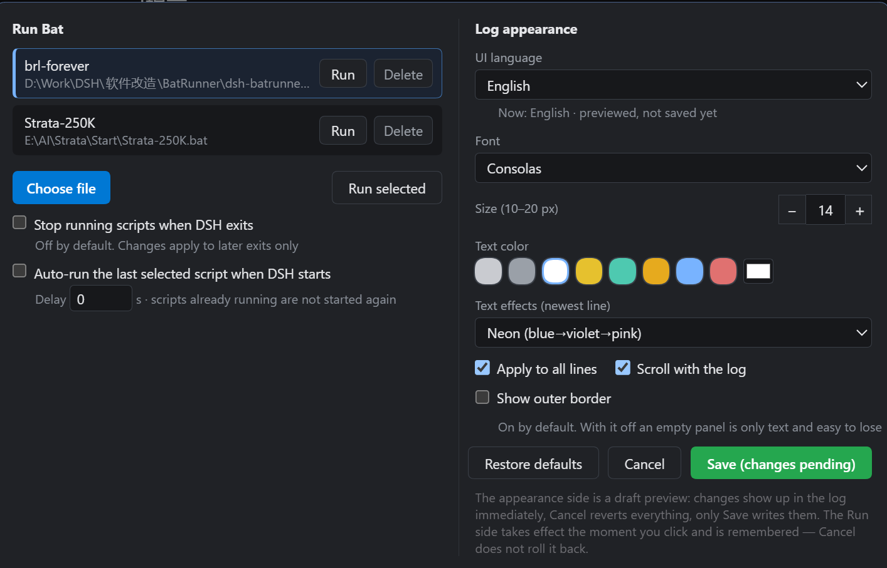

# dsh-bat-runner

<p align="center"></p>

<p align="center"><a href="./README.md"><b>简体中文</b></a> · <b>English</b></p>

**A plugin that runs any `.bat` script inside DSH: the terminal log shows up right on the DSH main window. Start and stop it, style the log panel, and drag or resize the panel freely.**

[](./assets/screenshot-running.png)

[](./assets/screenshot-empty.png)

[](./assets/screenshot-settings-en.png)

## Installation

- Install from the command line (currently available):

  ```bash
  dsh plugin --profile web add dsh-bat-runner
  ```

- Or search for **dsh-bat-runner** in the DSH plugin marketplace and install it (visible once the entry is listed).

After installing, **quit DSH completely and start it again**.

## Usage

1. Move the mouse to the top-right corner of the panel and click the gear **⚙** to open the settings panel.
2. The left half lets you pick a `.bat` script from disk and start it.
3. The right half adjusts the appearance of the log panel — font, effects, and the rest.

## Compatibility & Notes

- Windows only (it relies on `cmd`, PowerShell and `taskkill`).
- The panel shows the script's output exactly as it is; output is decoded as GBK by default, and as UTF-8 when the script itself sets `chcp 65001`.
- The panel keeps the most recent 40 lines by default; change that in the plugin's bundle configuration (`keepLines`).

## Updates

- **0.4.2**: Added a Forever log retention option.
- **0.4.1**: Added background color and opacity tuning for the log panel, and fixed the interface slowdown caused by long logs.
- **0.4.0**: Logs can be saved to disk, and the log panel scrolls so you can read the whole history.

---

<p align="center"><a href="./README.md"><b>简体中文</b></a> · <b>English</b></p>

## License

MIT
