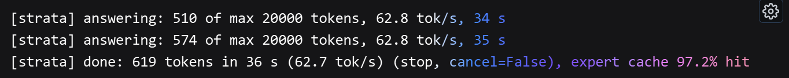
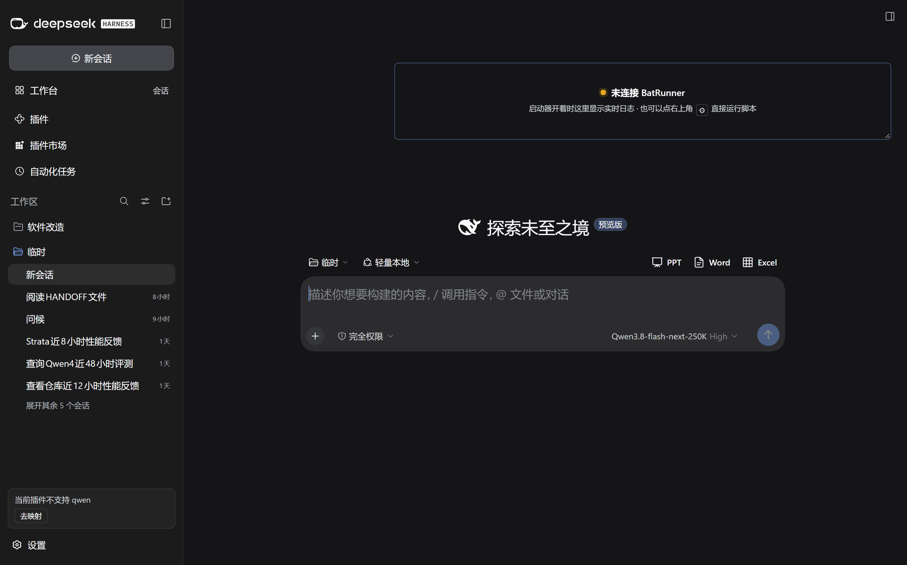
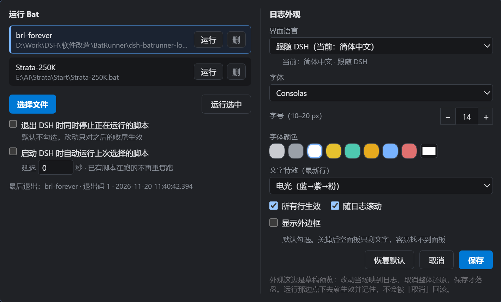

# dsh-bat-runner

<p align="center"></p>

<p align="center"><a href="./README.md"><b>简体中文</b></a> · <b>English</b></p>

**A plugin that runs any `.bat` script inside DSH: the terminal log shows up right on the DSH main window. Start and stop it, style the log panel, and drag or resize the panel freely.**

[](./assets/screenshot-running.png)

[](./assets/screenshot-empty.png)

[](./assets/screenshot-settings.png)

## What it does

- The panel floats on top of the DSH window. Drag it anywhere, resize it from the bottom-right corner; position and size are remembered.
- **Run Bat**: pick a `.bat` / `.cmd` file from disk. Each entry has one-click Run / Stop; **Stop** ends the whole process tree (Windows), not just the script.
- **Shows how long a script has been running**: a running entry carries an amber pill `● 已运行 14分35秒` to the right of its name, ticking once a second, gone the moment you press Stop.
- **Verbatim output**: exactly what the script printed — no timestamps, no levels, no coloring. Long lines wrap at the panel width instead of being truncated or cut with an ellipsis; the newest line is always at the bottom.
- **Interface language**: by default it **follows DSH** — switch DSH to English or Japanese and the plugin's own labels switch with it immediately, no restart needed. You can also pin one language in the settings window (简体中文 / 繁體中文 / English / 日本語 / 한국어 / Deutsch / Français / Русский / Italiano): once you pick one, the plugin keeps its own choice no matter what DSH does next, and it survives a restart; "Follow DSH" stays in that dropdown so you can hand control back at any time. **What your script prints is never touched** — not translated, no timestamps, no colouring.
- **Log appearance**: font, size 10–20 px, colour, 9 text shine effects, and an outer border toggle; colour and border follow the DSH light / dark theme.
- **Automatic behaviour**: *Run the last selected script when DSH starts* (with a 0–60 s delay), and *stop running scripts when DSH exits*.
- **Optional pairing**: with the BatRunner launcher open, the panel picks up the logs it forwards. The launcher is not required — the plugin runs scripts on its own.

## Install

- From the command line (works today):

  ```bash
  dsh plugin --profile web add dsh-bat-runner
  ```

- Or search **dsh-bat-runner** in the DSH plugin market.

After installing, **quit DSH completely and start it again** (`Ctrl+R` does not reload the plugin's client bundle).

## Usage

1. Hover the top-right corner of the panel and click the gear **⚙** to open the settings window.
2. Left half, **Run Bat**: click **选择文件** to pick a `.bat` / `.cmd`, then click **运行**. **Clicking a row selects it** (selected = blue background + a blue bar on the left; a running entry gets an orange frame, and both signals are visible at once). **运行选中** runs whichever entry is selected.
3. Right half, **日志外观**: the first option is the **interface language** (it follows DSH unless you pin one), then font, size, colour, effects and the outer border. Everything in this half previews as you change it — **only 保存 keeps it**, and **取消** puts it back (so does clicking the gear again, or the empty space outside the window).
4. A running entry cannot be deleted — **停止** first, then **删**. Stop kills the entire process tree.

## Compatibility & notes

- Windows only (it shells out to `cmd`, PowerShell and `taskkill`).
- Output is decoded as GBK by default; a script that runs `chcp 65001` is decoded as UTF-8.
- The panel's own labels follow DSH's interface language by default; you can also pin one of nine languages in the plugin's settings. Your script's own output is always shown verbatim, in any language.
- Pairing with the BatRunner launcher is **optional**: without it the panel shows "未连接 BatRunner", but **Run Bat** works normally.
- The panel keeps the last 40 lines by default; raise it with the bundle setting `keepLines`.

## Changelog

- **0.3.0**:
  - **The panel follows DSH's language**: with the default *Follow DSH*, switching DSH to English or Japanese switches every label the plugin writes immediately — no restart. You can also pin one language in the first option of the log-appearance half (简体中文 / 繁體中文 / English / 日本語 / 한국어 / Deutsch / Français / Русский / Italiano): a pinned choice wins over DSH, survives a restart, and *Follow DSH* stays in that dropdown so you can hand control back whenever you like.
  - **Status lines are assembled in your language**: things like `Reconnected to tick, which was already running before DSH restarted (script pid 7788)` or `Stopped (signal SIGKILL)` are built from the sentence in the language you chose, with the script name, pid, exit code and runtime filled in; duration units follow too (`1小时2分8秒` / `1h 2m 8s` / `1 Std 2 Min 8 s`). Hover titles, the panel title and every word in the settings window follow the same language.
  - **The system file picker follows as well**: its title and the "Batch files / All files" filter names appear in your language.
  - **Your script's output stays verbatim**: exactly what it printed — not translated, no timestamps, no colouring, in any language.
  - **Fixed: cancelling no longer leaves a language change behind.** Inside the window a language change is now only a preview: **Save** keeps it, **Cancel** (or clicking the gear again, or the empty space outside the window) reverts it. A small line spells it out — *previewed, not saved yet* — and the button reads *Save (changes pending)* until you commit. Font, size, colour, effects and the border already worked this way; language now does too.
  - Reminder: **quit DSH completely and start it again** after updating (`Ctrl+R` does not reload the plugin's client bundle).
- **0.2.1**:
  - **New one-line summary**: both the repository and the plugin market now say — a plugin that runs any `.bat` script inside DSH: the terminal log shows up right on the DSH main window; start and stop it, style the log panel, and drag or resize it freely.
  - **English documentation added**: the repository and the npm page still open in Chinese by default; click `English` under the title for the full English version, and the bottom line switches back.
  - **Screenshots replaced**: a new live shot of the panel printing a running script's terminal output on the DSH window; the settings screenshot is now the whole window, so both halves (Run Bat on the left, log appearance on the right) are in frame — the old one only caught the left half; all three images are now about half the previous area instead of filling the screen.
  - **Nothing about the plugin changed**: this release only touches documentation and images. Running scripts, start / stop, appearance settings and stop-on-exit behave exactly as in 0.2.0.
- **0.2.0**:
  - **Runtime shown next to the entry name**: a running script carries `● 已运行 14分35秒`, ticking once a second with units (`45秒` / `23分45秒` / `1小时23分45秒`). It disappears the moment you press Stop, and says nothing for an entry that is not running. After a DSH restart, a reclaimed script keeps counting from its original start time.
  - **Click a row to select it**: previously only pressing Run changed the selection, so "Run selected" kept pointing at the same entry. Clicking any row now selects it (blue background + blue left bar), and the cursor turns into a hand.
  - **Selection and running no longer look the same**: running draws an orange frame, selection a blue background; an entry that is both running and selected shows both signals instead of losing one.
  - **No more 2-second jumps in the timer**: the tick is aligned to wall-clock seconds, so each step is exactly 1 second.
  - **pid removed from the panel**: it sat in the way without telling you anything useful; hover the panel to see it in the title (the script's own pid is preferred).

---

<p align="center"><a href="./README.md"><b>中文说明</b></a> · <b>English</b></p>

## License

MIT
