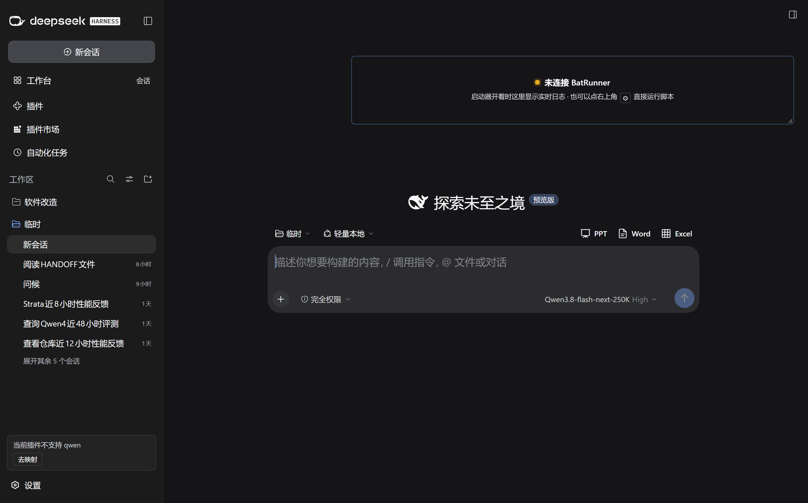
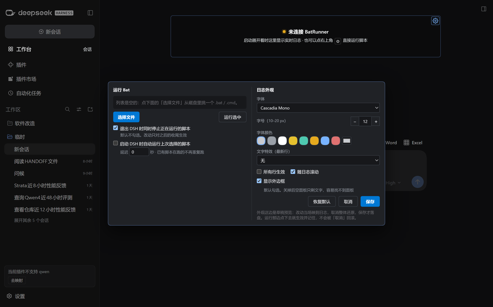

# dsh-bat-runner

<p align="center"></p>

**一个浮在 DSH 界面上的本地脚本日志面板：点一下就能运行 `.bat` / `.cmd`，输出逐字实时显示在面板里——不加时间戳、不分级、不着色。也可以把它接到 BatRunner 启动器上，直接看启动器转发的日志。**





## 它能做什么

- 面板常驻在 DSH 界面上，可拖动、可拉边框改大小；位置与尺寸会被记住。
- **运行 Bat**：从磁盘挑 `.bat` / `.cmd`，条目列表里一键运行 / 停止；「停止」会连它派生的子进程一起结束（Windows 进程树）。
- **输出逐字显示**：与脚本真实输出完全一致，按面板宽度整行折行，不截断、不加省略号；最新一行永远在最下面。
- **日志外观**：字体、字号 10–20px、颜色、9 种文字光带特效、是否显示外边框；颜色与边框跟随 DSH 的浅色 / 深色外观。
- **自动行为**：「启动 DSH 时自动运行上次选择的脚本」（带 0–60 秒延迟）；「退出 DSH 时同时停止正在运行的脚本」。
- **可选联动**：同时开着 BatRunner 启动器时，面板自动接收启动器转发的日志；不装启动器也能独立运行脚本。

## 安装

- 在 DSH 的「插件市场」搜索 **dsh-bat-runner** 安装；
- 或命令行安装：

  ```bash
  dsh plugin --profile web add dsh-bat-runner
  ```

安装后请**完全退出 DSH 再启动**（`Ctrl+R` 不会重载插件的客户端包）。

## 使用

1. 鼠标移到面板右上角，点齿轮 **⚙** 打开设置窗。
2. 左半「运行 Bat」：点 **选择文件** 挑一个 `.bat` / `.cmd`，再点 **运行**；也可以点「运行选中」。
3. 右半「日志外观」：调字体、字号、颜色、特效与外边框；改动会即时预览，点「保存」才落盘。
4. 运行中的条目不能删，先「停止」再删；「停止」结束的是整棵进程树。

## 兼容与说明

- 仅支持 Windows（依赖 `cmd`、PowerShell 与 `taskkill`）。
- 面板显示脚本原样输出；编码默认按 GBK 解码，脚本里写了 `chcp 65001` 的按 UTF-8。
- 与 BatRunner 启动器的联动是**可选功能**：检测不到启动器时面板显示「未连接 BatRunner」，但「运行 Bat」照常可用。
- 日志默认保留最近 40 行，可在插件的 bundle 配置里调整（`keepLines`）。

## 更新

- **0.1.0**：首个公开版本。悬浮日志面板、运行 / 停止本地 bat、日志外观设置、外边框开关、空态两行引导、DSH 浅深主题适配。

---

### English

A floating log panel for DeepSeek Harness. Run local `.bat` / `.cmd` scripts from the panel and see their output verbatim (no timestamps, levels or colors), or receive logs forwarded by the BatRunner launcher. Windows only. Install from the DSH plugin market or run `dsh plugin --profile web add dsh-bat-runner`, then fully restart DSH.

## License

MIT
