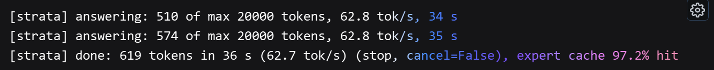

# dsh-bat-runner

<p align="center"></p>

<p align="center"><b>简体中文</b> · <a href="./README.en.md"><b>English</b></a></p>

**一个可以在DSH中运行任何bat脚本的插件，终端日志直接显示在DSH主界面，可控制启停，可设置日志面板外观，可任意拖动/缩放。**

[](./assets/screenshot-running.png)

[](./assets/screenshot-empty.png)

[](./assets/screenshot-settings.png)

## 安装

- 命令行安装（当前可用）：

  ```bash
  dsh plugin --profile web add dsh-bat-runner
  ```

- 或在 DSH 的「插件市场」搜索 **dsh-bat-runner** 安装（市场收录后可见）。

安装后请**完全退出 DSH 再启动**。

## 使用

1. 鼠标移到面板右上角，点齿轮 **⚙** 打开设置面板。
2. 面板左半部分支持打开磁盘选择bat脚本，启动运行。
3. 面板右半部分支持调整日志面板的外观、字体、特效等。

## 兼容与说明

- 仅支持 Windows（依赖 `cmd`、PowerShell 与 `taskkill`）。
- 面板显示脚本原样输出；编码默认按 GBK 解码，脚本里写了 `chcp 65001` 的按 UTF-8。
- 日志默认保留最近 40 行，可在插件的 bundle 配置里调整（`keepLines`）。

## 更新

- **0.4.0**：增加保存日志功能，日志面板可上下滚动查看全部内容。
- **0.3.0**：设置面板支持切换界面语言。
- **0.2.1**：新增英文 README，重拍设置窗与日志实拍图。

---

<p align="center"><b>简体中文</b> · <a href="./README.en.md"><b>English</b></a></p>

## License

MIT
